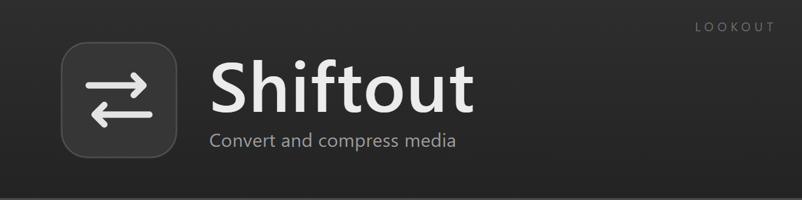
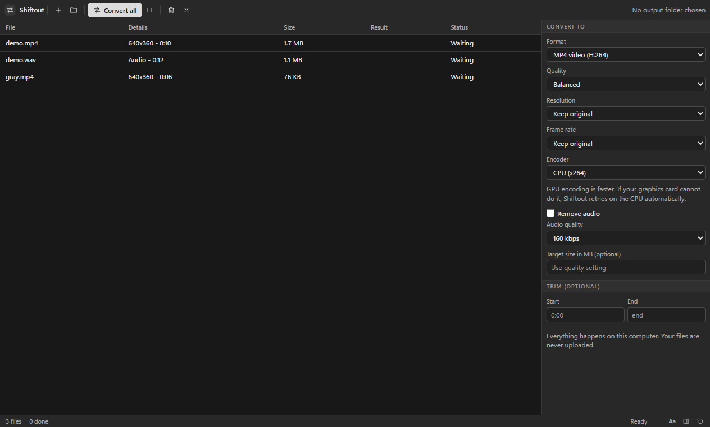
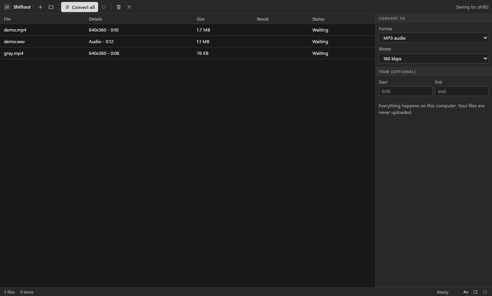
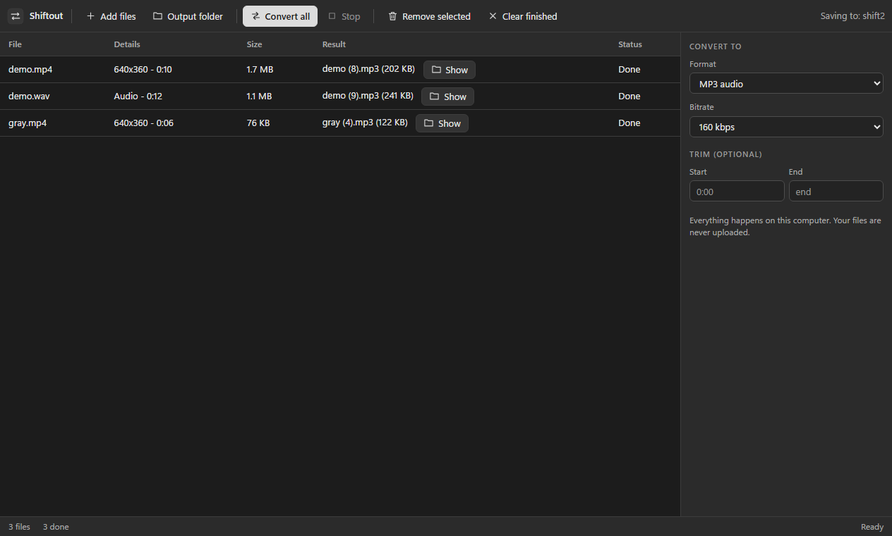
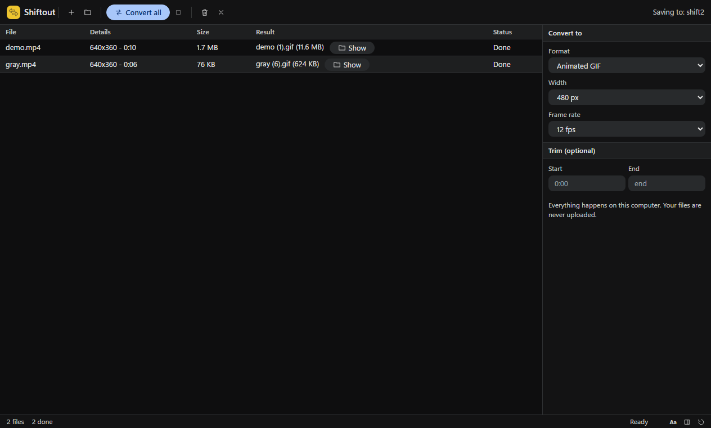

<b>Convert and compress media</b> Version 1.0.3 for Windows · Free · Offline · No account

<a href="https://github.com/plawanpawin-byte/shiftout/releases/latest"><b>Download Shiftout</b></a> · <a href="https://github.com/plawanpawin-byte/Lookout">All Lookout apps</a>

---

Shiftout converts video and audio between formats, shrinks large files and makes GIFs. Add as many files as you like, choose a target, and convert them all in one go. Everything runs on your computer using a bundled copy of FFmpeg.

**Made for:** For when a file will not play on a device, is too big to send, or you only need the audio from a video.

**On this page:** [Screenshots](#see-it-in-action) · [Interface](#the-interface) · [Features](#everything-it-can-do) · [How to use it](#how-to-use-it) · [Shortcuts](#keyboard-shortcuts) · [Formats](#files-and-formats) · [Privacy](#private-by-design) · [Install](#install) · [Questions](#questions)

## What is new in 1.0.3

A refreshed interface: every toolbar button now has a clear line icon, the app's mark sits at the top left, controls share one height and spacing, panels line up in tidy grids, and the toolbar keeps every button reachable on smaller windows by switching less important buttons to icons.

## See it in action

### The queue

Added files with their size, resolution and length. The conversion settings sit in the right panel.

### Choosing a format

Pick MP4, MKV, MOV, WebM, GIF, MP3, AAC, WAV, FLAC or Opus. The settings change to match.

### Batch result

Every file finished, with the new file name and size. Existing files are never overwritten.

### Making GIFs

Turn a clip into an animated GIF with a chosen width and frame rate.

### Output: audio

The MP3 produced from a video, drawn as a spectrogram.

### Output: GIF

A frame from the animated GIF made from the clip.

## The interface

- **Top bar:** add files, choose the output folder, convert all, stop, remove and clear.
- **Queue (centre):** every file with its details, size, result and status.
- **Right panel:** target format and its settings, and the optional trim.

## Everything it can do

### Targets

- Video: MP4 (H.264), MKV, MOV and WebM (VP9)
- Animated GIF
- Audio: MP3, AAC (M4A), WAV, FLAC and Opus

### Settings

- Quality presets
- Resolution: keep original, 1080p, 720p, 480p or 360p
- Frame rate: keep original, 60, 30, 24 or 15
- Remove the audio track, or choose its bitrate
- Aim for a target file size in MB
- Trim with start and end times

### Batch

- Convert many files in one run
- Stop at any time
- Choose the output folder
- Show the finished file in its folder

## How to use it

1. Click **Add files** and choose videos or audio.
2. Click **Output folder** and pick where results go.
3. Choose a format and adjust the settings.
4. Click **Convert all** and follow progress in the Status column.
5. Click **Show** to open the finished file.

## Keyboard shortcuts

| Keys | What it does |
| --- | --- |
| Ctrl + click, Shift + click | Select several rows |

## Files and formats

Reads almost any common video or audio file. Writes the formats listed above.

## Private by design

- No account, no sign-in, no subscription, no ads.
- Shiftout works offline. It never uses the network.
- Files are opened and saved only through the Windows file dialogs you use. Shiftout cannot browse your disk on its own.
- The app window runs in a locked-down sandbox with a strict content policy.

## Install

1. Open the [latest release](https://github.com/plawanpawin-byte/shiftout/releases/latest) and download the file named **Shiftout-Setup-** followed by the version number and **.exe**. You can also install it from the [Lookout launcher](https://github.com/${OWNER}/lookout-launcher), which keeps it up to date.
2. Run the installer. It installs just for you, so it does not ask for administrator rights.
3. Windows may show a blue **Windows protected your PC** screen because these installers are not signed with a paid certificate. Click **More info**, then **Run anyway**.
4. Open Shiftout from the Start menu.

**Requirements:** Windows 10 or 11, 64-bit. About 500 MB of free disk space. No internet connection is needed to use the app.

## Questions

**Are my files uploaded?**  
Never. Shiftout does not use the network.

**Can it overwrite my original?**  
No. If a name is already taken, a number is added to the new file.

## About Lookout

Shiftout belongs to the **[Lookout](https://github.com/plawanpawin-byte/Lookout)** family: ten small, private Windows apps for documents and media, all with the same calm grey look and the same promise that your files stay yours. Install and update them together with the [Lookout launcher](https://github.com/plawanpawin-byte/lookout-launcher).

- **[Pageout](https://github.com/plawanpawin-byte/pageout)**: read, annotate and sign pdfs
- **[Chartout](https://github.com/plawanpawin-byte/chartout)**: flowcharts and diagrams
- **[Branchout](https://github.com/plawanpawin-byte/branchout)**: mind maps and outlines
- **[Planout](https://github.com/plawanpawin-byte/planout)**: plans and gantt timelines
- **[Frameout](https://github.com/plawanpawin-byte/frameout)**: screen design and prototypes
- **[Cutout](https://github.com/plawanpawin-byte/cutout)**: video editing on a timeline
- **[Castout](https://github.com/plawanpawin-byte/castout)**: record your screen
- **[Mendout](https://github.com/plawanpawin-byte/mendout)**: repair damaged media
- **[Tuneout](https://github.com/plawanpawin-byte/tuneout)**: record and edit audio

Released under the MIT License.
