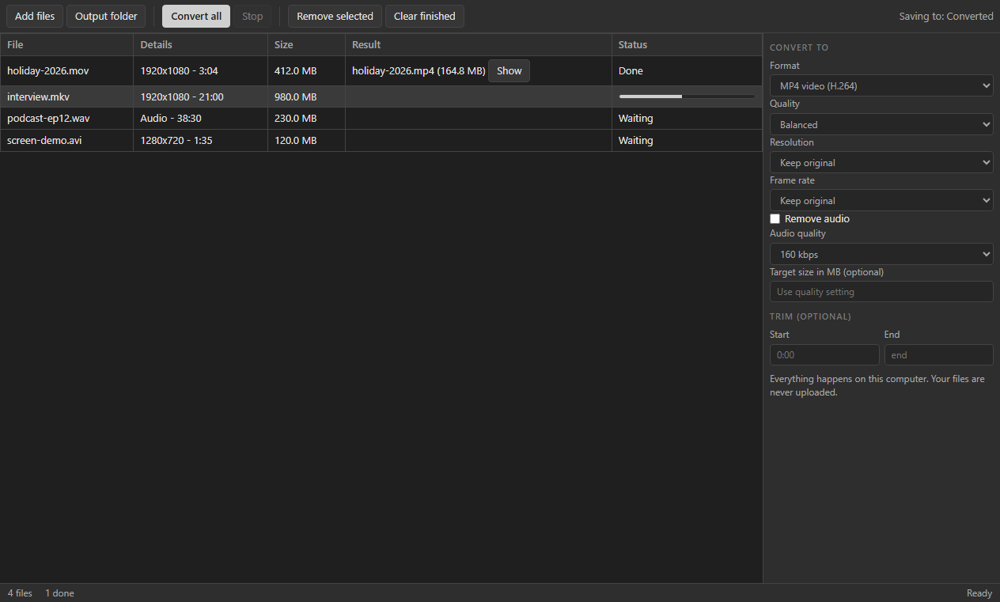

# Shiftout

A simple, private media converter for Windows. Convert video and audio between formats, shrink big files, make GIFs and process a whole batch at once, with no account, no watermark and no internet connection.

## What you can do

- **Convert video** to MP4, MKV, MOV or WebM
- **Extract or convert audio** to MP3, AAC (M4A), WAV, FLAC or Opus
- **Make animated GIFs** from any video
- **Batch queue**: add many files, pick a format once, convert them all
- **Compress**: choose a quality level, a smaller resolution or frame rate, or set a **target file size in MB**
- **Trim** the start and end while converting
- Remove the audio track when you only need the picture
- Your original files are never changed

## Your files stay on your computer

Shiftout works entirely offline. There is no account, no upload and no tracking, and converted files are saved only to the folder you choose.

## Download

Get **Shiftout-Setup-1.0.0.exe** from the [Releases](../../releases/latest) page and run it.

Part of the [Lookout](https://github.com/plawanpawin-byte/Lookout) family of apps.

Released under the MIT License. Video and audio processing uses FFmpeg, which is licensed under the GNU GPL; see the notices included with the app.
