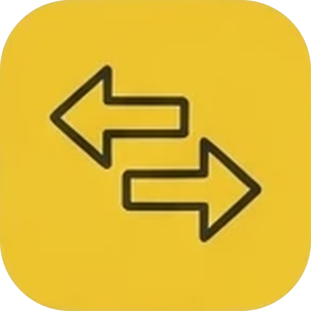

<h1 align="center">Shiftout</h1>

<b>Convert and compress media</b> Version 1.0.16 for Windows · Free · Offline · No account

<a href="https://github.com/plawanpawin-byte/shiftout/releases/latest"><b>Download Shiftout</b></a> · <a href="https://github.com/plawanpawin-byte/lookout-launcher">Lookout launcher</a> · <a href="https://github.com/plawanpawin-byte/Lookout">All Lookout apps</a>

---

Shiftout converts video and audio between formats, shrinks large files and makes GIFs. Add as many files as you like, choose a target, and convert them all in one go. Everything runs on your computer using a bundled copy of FFmpeg.

**Made for:** For when a file will not play on a device, is too big to send, or you only need the audio from a video.

**On this page:** [In plain words](#in-plain-words) · [Who it is for](#who-it-is-for) · [Try it in 3 steps](#try-it-in-3-steps) · [Screenshots](#see-it-in-action) · [Features](#everything-it-can-do) · [How to use it](#how-to-use-it) · [Privacy](#private-by-design) · [Install](#install) · [Questions](#questions)

## In plain words

Shiftout **converts media files from one format to another**. Maybe a video will not play on your phone, an audio file is too large to email, or you want a short **GIF** from a video. You add the files, pick what you want them to become (for example MP4, MP3 or GIF) and Shiftout does the work.

You can add **many files at once** and convert them all in one batch. It can also shrink big files by lowering the quality a little, so they take up less space. A bundled copy of the tool FFmpeg does the real work, all on your own computer.

**Not for:** Shiftout changes the format of a file. To cut or join clips use Cutout, and to fix a broken file use Mendout.

## Who it is for

- **Anyone with a file that will not open** on their device.
- **People who need smaller files** to email or upload.
- **Creators** making GIFs or extracting the sound track of a video.

## Try it in 3 steps

1. Click **Add files** and choose several videos or audio files.
2. Click **Add files**, then pick the target format in the right panel, for example MP3 for audio only.
3. Press **Convert all**, then click **Show** to open a finished file.

## What is new in 1.0.16

A new look inspired by Google's own tools (AI Studio, Colab, Gemini): a calm dark charcoal theme, rounded pill buttons, a soft blue accent and roomier spacing. The app icon is now a colour logo so you can find Shiftout at a glance in the Start menu and in the Lookout launcher. All screenshots below were taken again with the new look.

## In plain words

Shiftout **converts media files from one format to another**. Maybe a video will not play on your phone, an audio file is too large to email, or you want a short **GIF** from a video. You add the files, pick what you want them to become (for example MP4, MP3 or GIF) and Shiftout does the work.

You can add **many files at once** and convert them all in one batch. It can also shrink big files by lowering the quality a little, so they take up less space. A bundled copy of the tool FFmpeg does the real work, all on your own computer.

**Not for:** Shiftout changes the format of a file. To cut or join clips use Cutout, and to fix a broken file use Mendout.

## Who it is for

- **Anyone with a file that will not open** on their device.
- **People who need smaller files** to email or upload.
- **Creators** making GIFs or extracting the sound track of a video.

## Try it in 3 steps

1. Click **Add files** and choose several videos or audio files.
2. Click **Add files**, then pick the target format in the right panel, for example MP3 for audio only.
3. Press **Convert all**, then click **Show** to open a finished file.

## See it in action

### The queue

Added files with their size, resolution and length. The conversion settings sit in the right panel.

### Choosing a format

Pick MP4, MKV, MOV, WebM, GIF, MP3, AAC, WAV, FLAC or Opus. The settings change to match.

### Batch result

Every file finished, with the new file name and size. Existing files are never overwritten.

### Making GIFs

Turn a clip into an animated GIF with a chosen width and frame rate.

### Output: audio

The MP3 produced from a video, drawn as a spectrogram.

### Output: GIF

A frame from the animated GIF made from the clip.

## The interface

- **Top bar:** add files, choose the output folder, convert all, stop, remove and clear.
- **Queue (centre):** every file with its details, size, result and status.
- **Right panel:** target format and its settings, and the optional trim.

## Everything it can do

### Targets

- Video: MP4 (H.264), MKV, MOV and WebM (VP9)
- Animated GIF
- Audio: MP3, AAC (M4A), WAV, FLAC and Opus

### Settings

- Quality presets
- Resolution: keep original, 1080p, 720p, 480p or 360p
- Frame rate: keep original, 60, 30, 24 or 15
- Remove the audio track, or choose its bitrate
- Aim for a target file size in MB
- Trim with start and end times

### Batch

- Convert many files in one run
- Stop at any time
- Choose the output folder
- Show the finished file in its folder

## How to use it

1. Click **Add files** and choose videos or audio.
2. Click **Output folder** and pick where results go.
3. Choose a format and adjust the settings.
4. Click **Convert all** and follow progress in the Status column.
5. Click **Show** to open the finished file.

## Keyboard shortcuts

| Keys | What it does |
| --- | --- |
| Ctrl + click, Shift + click | Select several rows |

## Files and formats

Reads almost any common video or audio file. Writes the formats listed above.

## Private by design

- No account, no sign-in, no subscription, no ads.
- Shiftout works offline. It never uses the network.
- Files are opened and saved only through the Windows file dialogs you use. Shiftout cannot browse your disk on its own.
- The app window runs in a locked-down sandbox with a strict content policy.

## Install

1. Open the [latest release](https://github.com/plawanpawin-byte/shiftout/releases/latest) and download the file named **Shiftout-Setup-** followed by the version number and **.exe**. You can also install it from the [Lookout launcher](https://github.com/plawanpawin-byte/lookout-launcher), which keeps it up to date.
2. Run the installer. It installs just for you, so it does not ask for administrator rights.
3. Windows may show a blue **Windows protected your PC** screen because these installers are not signed with a paid certificate. Click **More info**, then **Run anyway**.
4. Open Shiftout from the Start menu.

**Requirements:** Windows 10 or 11, 64-bit. About 500 MB of free disk space. No internet connection is needed to use the app.

## Questions

**Are my files uploaded?**  
Never. Shiftout does not use the network.

**Can it overwrite my original?**  
No. If a name is already taken, a number is added to the new file.

**What is a format?**  
The way data is stored in the file, shown by the ending of its name such as .mp4 or .mp3.

**Will quality be lost?**  
Converting between lossy formats can lose a tiny amount of quality. Choose a higher quality setting if it matters.

**Does it delete my originals?**  
No. Shiftout writes new files and leaves the originals alone.

**What is a format?**  
The way data is stored in the file, shown by the ending of its name such as .mp4 or .mp3.

**Will quality be lost?**  
Converting between lossy formats can lose a tiny amount of quality. Choose a higher quality setting if it matters.

**Does it delete my originals?**  
No. Shiftout writes new files and leaves the originals alone.

## About Lookout

Shiftout is part of **[Lookout](https://github.com/plawanpawin-byte/Lookout)**: ten small, private Windows apps for documents and media that share one look and one promise, that your files stay on your computer. Install and update them together with the [Lookout launcher](https://github.com/plawanpawin-byte/lookout-launcher).

| | App | What it is for | Code |
| --- | --- | --- | --- |
|  | **Lookout** | Install, open and update all the apps below | [GitHub](https://github.com/plawanpawin-byte/lookout-launcher) |
|  | **Pageout** | Read, annotate and sign PDFs | [GitHub](https://github.com/plawanpawin-byte/pageout) |
|  | **Chartout** | Flowcharts, org charts and diagrams | [GitHub](https://github.com/plawanpawin-byte/chartout) |
|  | **Branchout** | Mind maps and outlines | [GitHub](https://github.com/plawanpawin-byte/branchout) |
|  | **Planout** | Project plans and Gantt timelines | [GitHub](https://github.com/plawanpawin-byte/planout) |
|  | **Frameout** | App and web screen design with click-through prototypes | [GitHub](https://github.com/plawanpawin-byte/frameout) |
|  | **Cutout** | Video editing on a timeline | [GitHub](https://github.com/plawanpawin-byte/cutout) |
|  | **Shiftout** | Convert and compress video and audio, make GIFs | [GitHub](https://github.com/plawanpawin-byte/shiftout) |
|  | **Castout** | Record your screen | [GitHub](https://github.com/plawanpawin-byte/castout) |
|  | **Mendout** | Check and repair damaged video, audio, pictures and PDFs | [GitHub](https://github.com/plawanpawin-byte/mendout) |
|  | **Tuneout** | Record and edit audio | [GitHub](https://github.com/plawanpawin-byte/tuneout) |

Released under the MIT License.
